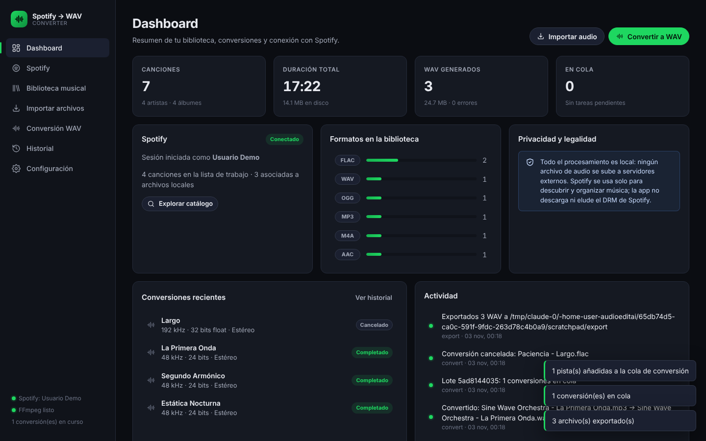
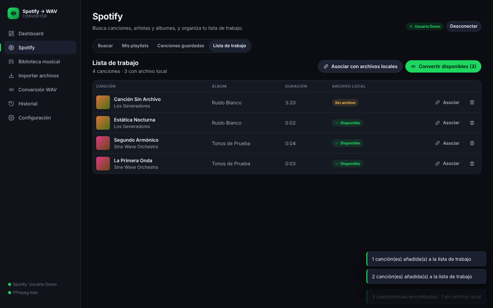
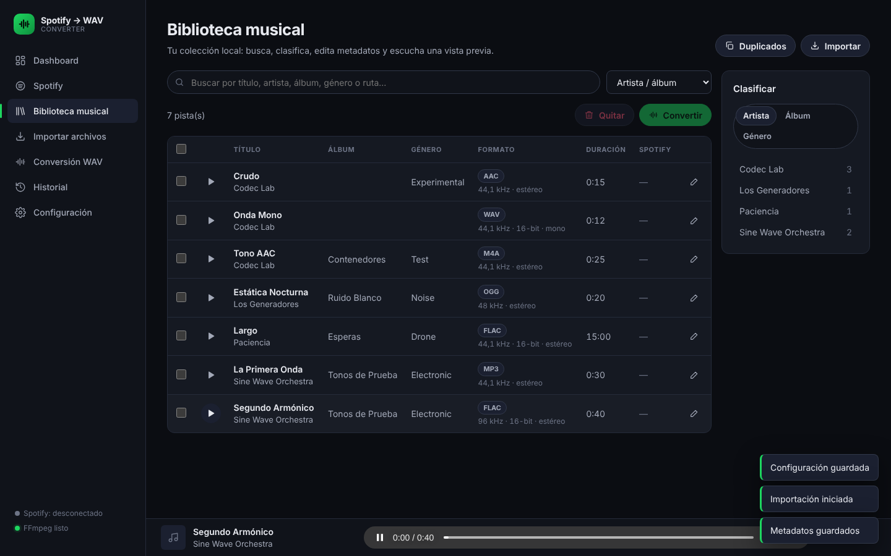
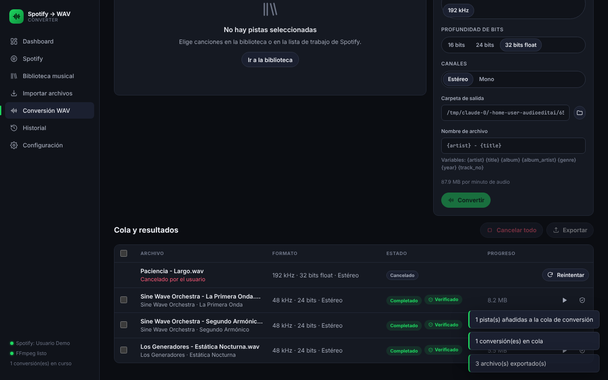

# Spotify to WAV Converter

Aplicación de escritorio para **descubrir y organizar música con Spotify**, **gestionar una biblioteca local** y
**convertir archivos de audio legales a WAV de alta calidad** con FFmpeg. Todo el procesamiento es local.

> Spotify se usa solo para consultar el catálogo y tus listas (metadatos). La aplicación **no descarga, extrae ni
> elude el DRM** de Spotify: lo que se convierte son tus propios archivos (MP3, FLAC, M4A, AAC, OGG, WAV).



| Spotify (lista de trabajo) | Biblioteca | Conversión |
|---|---|---|
|  |  |  |

## Funcionalidades

| Sección | Qué hace |
|---|---|
| **Dashboard** | Estadísticas (canciones, duración, WAV generados, cola), estado de Spotify, formatos, conversiones recientes y actividad. |
| **Spotify** | Conexión OAuth (Authorization Code + PKCE, sin Client Secret). Búsqueda de canciones, artistas y álbumes; tus playlists y canciones guardadas; portadas, títulos, artistas y duración. Lista de trabajo con **asociación automática** (título/artista/duración) o manual con tus archivos locales, y botón para convertir las disponibles. |
| **Biblioteca musical** | Búsqueda, clasificación por artista / álbum / género, ordenación, edición de metadatos (en la base de datos y opcionalmente en las etiquetas del archivo), vista previa con reproductor, detección de duplicados (idénticos por SHA-256 y probables por artista+título+duración). |
| **Importar archivos** | Archivos sueltos o carpetas completas (recursivo), lectura de metadatos con mutagen/FFprobe (o deducidos del nombre de archivo), omisión de duplicados exactos, rechazo de archivos dañados, progreso y cancelación. |
| **Conversión WAV** | 44,1 / 48 / 88,2 / 96 / 192 kHz · 16 bits / 24 bits / 32 bits float · mono / estéreo. Individual o por lotes, cola persistente con N conversiones simultáneas, progreso en vivo, cancelar una o todas, reintentar, **verificación de integridad** y exportación a una carpeta (copia verificada por hash). |
| **Historial** | Conversiones (filtrables por estado) y registro de operaciones (info / avisos / errores). |
| **Configuración** | Client ID y Redirect URI de Spotify, formato por defecto, carpeta de salida, patrón de nombres, simultaneidad, verificación, información del sistema. |

### Calidad de conversión
- Remuestreo con **SoX Resampler** (`soxr`, precisión 28 bits) cuando FFmpeg lo incluye.
- **Dither triangular** al reducir a 16 bits.
- PCM `pcm_s16le` / `pcm_s24le` / `pcm_f32le`, se conservan los metadatos, RF64 automático para archivos > 4 GB.
- Se escribe en un archivo temporal `.part` y se renombra solo si FFmpeg termina bien.
- Verificación posterior: contenedor, códec, frecuencia, canales, duración frente al original y **decodificación completa** del WAV sin errores; se guarda el SHA-256 del resultado.

## Arquitectura

```
┌───────────── Electron (desktop/) ─────────────┐
│  ventana nativa · diálogos de archivo/carpeta │
│  arranca y detiene el backend                 │
└──────────────┬────────────────────────────────┘
               │ http://127.0.0.1:8765
┌──────────────▼───────── Backend Python (backend/swc) ─────────────────┐
│ FastAPI app.py ── API REST + sirve frontend/ (HTML/CSS/JS sin build)   │
│ services/                                                             │
│   audio.py      FFmpeg/FFprobe: probe, conversión, progreso, verify   │
│   converter.py  cola persistente, hilos, cancelación, reintentos      │
│   library.py    importación, metadatos, duplicados, facetas           │
│   metadata.py   lectura/escritura de etiquetas (mutagen)              │
│   spotify.py    OAuth PKCE + Web API (solo metadatos)                 │
│   matcher.py    asociación Spotify ↔ archivos locales                 │
│   exporter.py   exportación con verificación de hash                  │
│ db.py (SQLite) · oplog.py (tabla logs + archivo rotativo)             │
└───────────────────────────────────────────────────────────────────────┘
```

- **Modular**: cada servicio es independiente y se cablea en `Services` (`app.py`); añadir funciones nuevas = un servicio + rutas.
- **Estable**: un solo proceso local, SQLite en modo WAL, trabajos persistentes (los que estaban en cola se reanudan; los interrumpidos se marcan como fallidos).
- **Seguro**: el servidor solo escucha en `127.0.0.1`, rechaza cabeceras `Host` ajenas (DNS rebinding) y exige la cabecera `X-SWC` en peticiones que modifican datos (CSRF). CSP estricta en el frontend.
- **Datos** en `~/.spotify-wav-converter/` (`library.db`, `logs/operations.log`, `converted/`). Cambiable con `SWC_DATA_DIR` o `--data-dir`.

## Requisitos
- Python 3.10+
- FFmpeg y FFprobe en el `PATH` (o variables `SWC_FFMPEG` / `SWC_FFPROBE`)
- Node.js 18+ (solo para la app de escritorio Electron)

## Puesta en marcha

```bash
pip install -r backend/requirements.txt

# Opción A: aplicación de escritorio (Electron)
cd desktop && npm install && npm start

# Opción B: sin Electron, en el navegador
python run.py --open            # http://127.0.0.1:8765
```

### Conectar Spotify
1. Crea una app en <https://developer.spotify.com/dashboard> (Web API).
2. Añade como Redirect URI: `http://127.0.0.1:8765/api/spotify/callback` (con `127.0.0.1`, no `localhost`).
3. Pega el **Client ID** en *Configuración* y pulsa *Conectar con Spotify* en la sección Spotify.

Las apps de Spotify en modo desarrollo solo admiten a los usuarios añadidos en el panel de la app.

## Pruebas

```bash
pip install -r backend/requirements-dev.txt
cd backend && python -m pytest          # 66 pruebas: audio, API, Spotify (servidor falso), cola, etc.

scripts/run_e2e.sh /tmp/swc-e2e         # E2E de la interfaz en Chromium (Playwright) con datos de demo
xvfb-run node e2e/desktop.e2e.js        # humo de la app Electron (requiere desktop/node_modules)
```

- `backend/tests/fake_spotify.py` implementa un Spotify falso (Accounts + Web API, con PKCE real) para probar todo el
  flujo OAuth, la búsqueda, playlists, álbumes, artistas y la renovación de tokens sin red.
- `backend/tests/demo_server.py` arranca la app con audio de ejemplo generado y el Spotify falso, útil para probar la
  interfaz a mano: `python backend/tests/demo_server.py --port 8799 --data-dir /tmp/swc-demo` (Client ID: `test-client-id`).

## API (resumen)
`GET /api/dashboard` · `GET/PUT /api/settings` · `POST /api/import` · `GET /api/library` · `PUT /api/library/{id}` ·
`GET /api/library/{id}/stream` · `GET /api/library/duplicates` · `GET /api/spotify/login|search|playlists|albums/{id}|artists/{id}` ·
`GET/POST /api/worklist` · `POST /api/worklist/match` · `POST /api/conversions` · `POST /api/conversions/{id}/cancel|retry|verify` ·
`POST /api/export` · `GET /api/logs`. Documentación interactiva en `http://127.0.0.1:8765/docs`.
